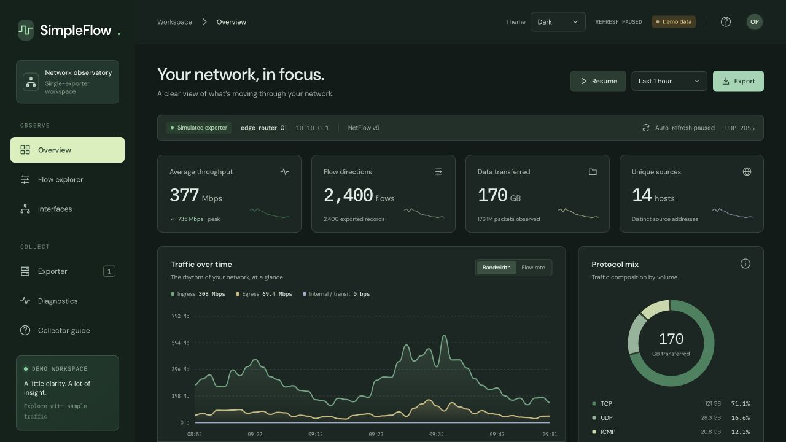
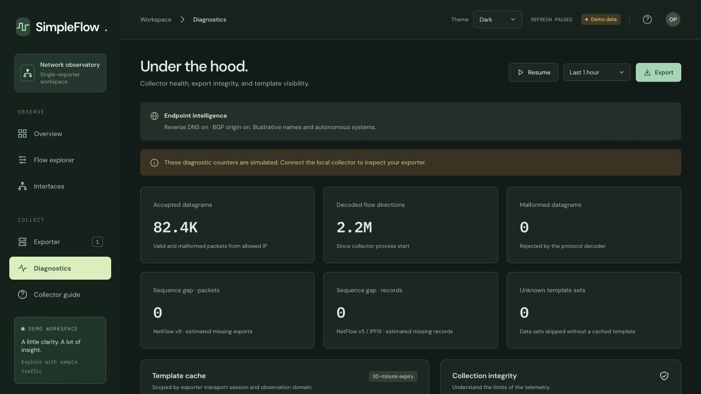

# SimpleFlow

A single-exporter NetFlow collector with a responsive web dashboard. Python 3.10+ and a browser are the only requirements; no pip or npm packages are needed.

The private hosted site is a **simulated demonstration**. Real UDP collection and data storage run on your machine. The hosted demo never receives your network telemetry.

## Screenshots

Both screenshots use simulated traffic and illustrative endpoint names in the dark theme.

### Overview

Throughput, flow counts, traffic trends, and protocol distribution at a glance.



### Diagnostics

Collector health, export integrity counters, and template visibility.



## Start collecting

```sh
git clone https://github.com/jneighbo/simpleflow2.git
cd simpleflow2
python3 collector.py --exporter 10.10.0.1 --name edge-router-01 --networks 10.10.0.0/16
```

Replace `10.10.0.1` with the exporter's **source IPv4 address**. Configure the router to export to the collector host's LAN IP at **UDP 2055**. Open **http://127.0.0.1:8080** on the collector host. The listener accepts exactly one exporter IP and rejects all others; the transport source port and observation domain further scope templates.

If the default ports are occupied, choose alternatives:

```sh
python3 collector.py --exporter 10.10.0.1 --udp-port 22055 --http-port 8765
```

Use comma-separated internal CIDRs for direction classification. Defaults are RFC 1918 ranges. IPv6 flow endpoints are supported in templates; UDP exporter transport currently uses IPv4.

The HTTP server binds to loopback. To serve other machines, use an authenticated TLS reverse proxy. This lightweight collector has no built-in user authentication. Restrict UDP access to the exporter using a firewall; source-IP filtering alone is not authentication.

## Explore the demo

```sh
python3 collector.py --demo
```

Alternatively add `?demo=1` to a local dashboard URL. Demo mode is visibly labeled throughout the UI. For a static preview, serve `dist/` with any HTTP server and add `?demo=1`. The hosted version automatically selects demo mode when its local-only API is absent. The UI never silently swaps an established live session to demo after a connection failure.

## Views

Use the **Theme** selector in the top bar to choose Light, Dark, or System. Your choice is saved in this browser and applies across all views. System follows your operating system’s appearance.

- **Overview:** average throughput, peak receipt-bucket bandwidth, flow-direction and exported-record counts, bytes, packets, source counts, interactive traffic charts, protocol mix, top source addresses, and inferred services. Click protocols, services, or talkers to filter the explorer.
- **Flow explorer:** IP/hostname/port/protocol/origin-AS/organization search, protocol/direction/service filters, byte sorting, pagination, CSV export, and a detailed record drawer.
- **Interfaces:** exported input/output ifIndex and observed average ingress/egress rates. Capacity, device interface names, and operational status require SNMP and are not collected. Friendly interface names in the demo are illustrative.
- **Exporter:** single-source identity, accepted formats, freshness, internal networks, retention, and startup guidance.
- **Diagnostics:** valid-source datagram count, decoded records, malformed datagrams, estimated sequence gaps, rejected sources, options record count, cache contents, and restart/reordering counters. Counters reset on service restart; stored flows persist.

The record drawer exposes IPv4/IPv6 endpoints, source/destination ports, protocol, byte/packet counters, duration when exported, TCP flags, DSCP/ToS, source/destination AS, next hop, prefix lengths, input/output ifIndex, observation domain or engine ID, sampling interval when available, and export/receipt timestamps.

## Supported export data

- NetFlow v5 fixed records, with header sampling interval and engine identity.
- NetFlow v9 template records, options-template parsing, observation domains, and template caching.
- UDP IPFIX version 10, IPv4/IPv6 fields, reduced-size integer counters, RFC 5103 bidirectional fields, variable-length fields, and options records.
- Common standard information elements: 1, 2, 4–17, 21, 22, 27–30, 62, 85, 86, 150–157, 195.
- IPFIX reverse information elements (enterprise number 29305) are decoded into paired forward/reverse directions, including separate bytes, packets, TCP flags, and ToS. Unknown enterprise fields are consumed but not interpreted. Options data is counted but not applied to sampling or interface metadata. UDP template withdrawals are rejected. Templates expire after 30 minutes; configure periodic refresh on the exporter.
- V5/v9 exporter uptime rollback invalidates session templates and sequence expectations. Out-of-order packets can also trigger this conservative reset.

Format references: [Cisco NetFlow datagram formats](https://www.cisco.com/c/en/us/td/docs/net_mgmt/netflow_collection_engine/5-0-3/user/guide/format.html), [NetFlow v9 / RFC 3954](https://www.rfc-editor.org/rfc/rfc3954.html), and [IPFIX / RFC 7011](https://www.rfc-editor.org/rfc/rfc7011.html).

## Measurement semantics and limits

- Counters are **raw and not sampling-adjusted**. V5 sampling intervals are displayed; v9/IPFIX sampling options are not decoded. Do not interpret the charts as full wire volume when using sampled exports.
- Time windows and charts use **collector receipt time**, with 48 equal-width buckets. A router that batches exports can create apparent spikes. The average is total bytes × 8 / selected window duration, including quiet periods.
- Direction is derived from configured internal networks: outside→inside is ingress, inside→outside is egress, inside→inside is internal, and outside→outside is transit. The chart groups internal and transit together.
- Application labels use known ports, not DPI or hostname enrichment. A port does not prove an application.
- Flow counts represent normalized **directions**, not unique concurrent sessions. An RFC 5103 bidirectional record produces two rows linked by a conversation ID; both directions contribute their own counters to totals. The overview also shows the original exported-record count. Sequence tracking counts original wire records. Zero-counter reverse directions remain visible. A long flow may be exported multiple times; there is no deduplication. Data collected before reverse-field support cannot recover its missing reverse counters.
- Missing scalar fields currently display as zero; missing flow duration, sampling, or prefixes display as unavailable. Next hop displays unavailable when absent.
- Sequence gaps estimate missing **packets for v9** and missing **records for v5/IPFIX**. UDP reordering/restarts can affect the estimate. An IPFIX unknown-template set clears the expected sequence count until a decodable message arrives.
- SQLite retains the most recent **250,000 records or 24 hours**, whichever is reached first. Retention cleanup runs on ingestion, at most once a minute. The row cap can be exceeded between cleanups. Use `--retention-hours` for 1–720 hours. Data lives in `.data/flows.sqlite3` and is excluded from source publication.
- Dashboard aggregation covers retained records within the chosen window. The explorer and CSV export expose the newest 2,000 records in that window; a banner indicates truncation. CSV from the explorer respects current filters. The demo contains 2,400 synthetic records.
- This is a lightweight collector, not a distributed/high-throughput flow warehouse. It uses a single decoder thread with synchronous SQLite writes. Throughput has not been load-benchmarked, and kernel UDP drops are not counted. No alerts, GeoIP, SNMP polling, or packet capture are performed by the collector.

## Endpoint intelligence

Reverse DNS and BGP origin lookups run in bounded background workers. Flow ingestion never waits for a lookup. Hostnames and origin AS names appear beneath endpoints in the flow table and top talkers. Search by hostname, ASN (for example `AS15169`), organization, or routed prefix. Open a flow for both endpoint details, provider and lookup time; CSV exports include the enrichment fields and lookup status. Exporter-supplied AS fields remain separate and unchanged.

- **PTR names:** use the collector machine's OS resolver, including private/internal DNS. Point that machine at a resolver able to resolve your pfSense DHCP hostnames if desired. No PTR record is a normal result; an IP may also map to an infrastructure name rather than the service you visited.
- **BGP origins:** public unicast IPs are sent to [RIPEstat network-info](https://stat.ripe.net/docs/data-api/api-endpoints/network-info.html) for origin ASNs and routed prefix; [AS overview](https://stat.ripe.net/docs/data-api/api-endpoints/as-overview) supplies organization labels. Multiple origins are preserved. Private, shared, documentation, multicast, and other special addresses are never sent to that provider.
- This identifies the **current BGP origin network**, not a transit AS path, geographic location, or historical ownership at the time of a flow. Results reflect RIPE RIS observations and may lag routing changes. NAT and the observation interface determine which endpoint addresses are visible in exports.
- Lookups are enabled by default. Use `--no-rdns` and/or `--no-asn` to disable them. ASN lookup sends the public endpoint IP only, without ports, counters, or private addresses. DNS follows your system resolver configuration.
- Cache: `.data/enrichment.sqlite3`, excluded from source publication. PTR entries cache for 15 minutes, missing PTR results for 5 minutes, origin data for 8 hours, and AS names for 24 hours. Lookup errors retry after 2 minutes and retain earlier values. Each queue holds at most 256 waiting addresses; repeated requests are coalesced, and provider requests are spaced at one per second. New entries appear on dashboard refresh. Large endpoint sets fill in gradually.

## pfSense / softflowd IPFIX

Set the export destination to the collector machine's LAN IP, select UDP port `22055` when using the alternate startup command above, and choose IPFIX. Bidirectional exports (`softflowd -b`) are supported for IPv4 and IPv6. Templates must refresh periodically; after restarting the collector, data received before its template is skipped and counted under unknown-template sets.

The flow drawer links to the opposite direction when both rows are in the explorer's current window. softflowd can export a shared conversation lifetime; it is labeled explicitly. Reverse TCP flags and counters are kept separate. softflowd can also populate input and output with the same observation ifIndex, so adding those two interface rates counts the same observation twice; overall traffic totals do not use that sum.

## Verify locally

```sh
python3 -m unittest discover -s tests -v
node --check dist/app.js
node tests/test_frontend.cjs
```

To exercise the actual UDP listener, start a collector with the default allowlisted source `127.0.0.1`, then send synthetic test exports:

```sh
python3 collector.py --http-port 8765 --udp-port 22055
# In another terminal:
python3 send_sample.py --port 22055 --packets 20
```

Open **http://127.0.0.1:8765** without `?demo=1` to inspect the received synthetic packets through the live pipeline. Use a separate `--db` path for testing when preserving production data matters.

The web frontend is buildless (`dist/index.html`, `dist/styles.css`, `dist/app.js`). The API is `GET /api/snapshot?minutes=60`; accepted ranges are 15, 60, 360, and 1440 minutes. Fonts load from Google Fonts with local system fallbacks.
